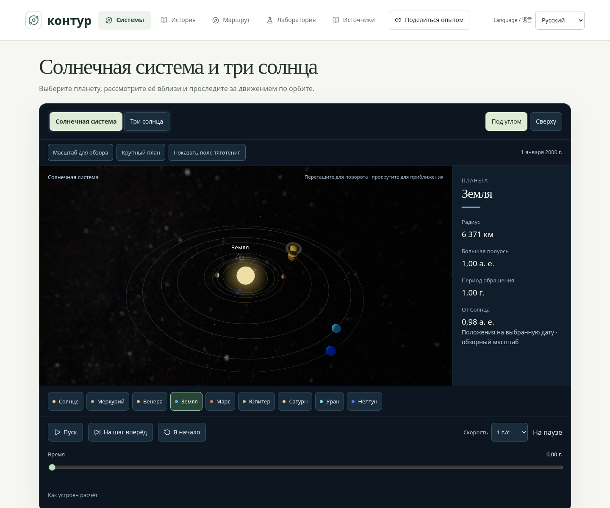
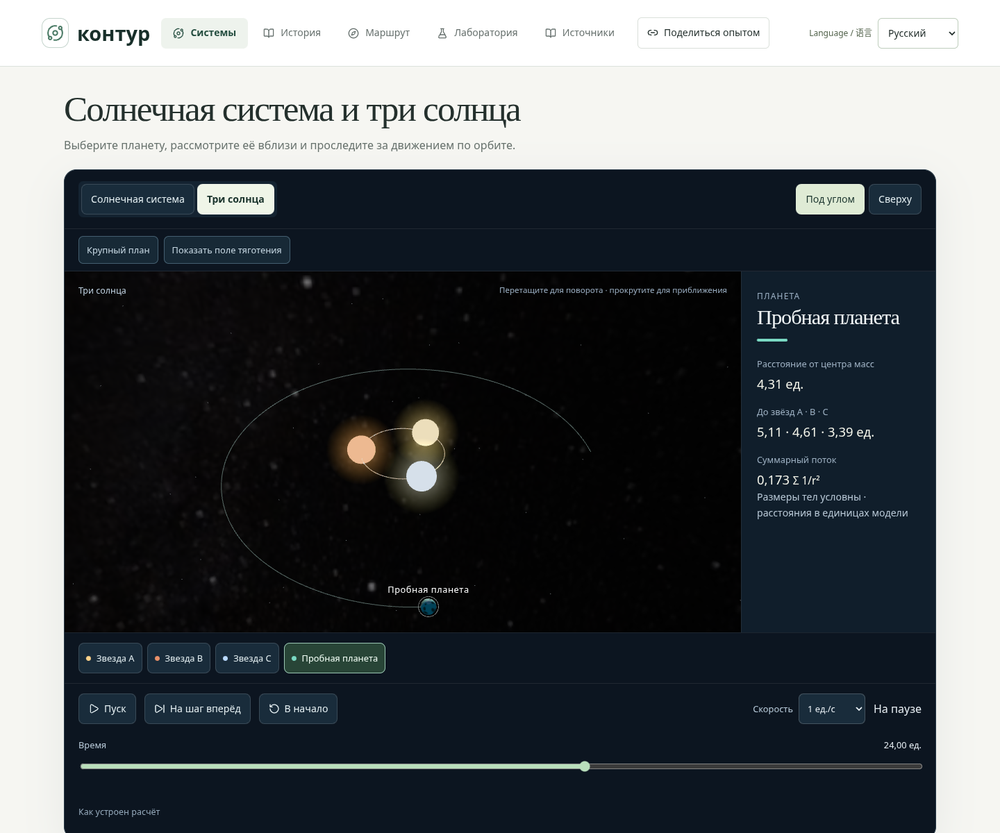

# Kontur · Контур · 界线

Explore the Solar System and a world with three suns, then test the geometry and motion behind what you see. Rotate the view, follow a planet, or compare nearby initial conditions in six guided experiments inspired by Liu Cixin’s trilogy.

The interface is available in **Russian and Simplified Chinese**. This README and the [model notes](docs/models.md) are in English.

[Open the live demo](https://mmkolpakov.github.io/Geometry-System/) · [Download a release](https://github.com/mmkolpakov/Geometry-System/releases)

## A look inside



*The Solar System: select a planet and follow its orbit.*



*Three suns and a moving planet: follow its path and the changing light.*

## Explore

- **Curious about space?** Start with the Solar System. Select a planet, rotate the camera and change the playback speed. The three-sun view follows a planet in the combined field of three stars.
- **Coming from the books or series?** Each experiment connects a scientific question to a literary idea. Story details and related links open only after a spoiler warning.
- **Preparing a lesson?** Ask for a prediction, change one parameter, and discuss the result. The three-body lab supports pause, step and reset; a shared URL reproduces the selected parameters and frame.
- **Reviewing the code?** Read the [equations, assumptions and sources](docs/models.md), then inspect `src/domain/` and its tests. The plots and numerical readouts use the same model data.

The six experiments cover shortest paths, a spherical triangle with three right angles, the Poincaré disk and projection, the Lagrange triangle, the figure-eight orbit, and nearby initial states. Geometry describes two-dimensional spaces; orbital motion uses Newtonian point masses. These are educational models, not reconstructions of a fictional planetary system.

## Run locally

Use **Node.js 22.12 or newer**; `.nvmrc` selects Node 22.

```sh
git clone https://github.com/mmkolpakov/Geometry-System.git
cd Geometry-System
npm ci
npm run dev
```

Open [localhost:3000](http://localhost:3000). No account, API key, backend or database is required.

The browser saves which lesson questions you answered correctly. Shared links contain model settings, language and frame, but no answer history or completion marks. Story disclosure is local to the current view and is not saved or shared. The app contains no analytics tracker.

## Build and test

```sh
npx playwright install chromium
npm run check
```

`check` runs TypeScript, unit tests, a production build and end-to-end tests. On Linux, use `npx playwright install --with-deps chromium` to install browser system libraries as well. An existing Chromium executable can be selected with `PLAYWRIGHT_CHROMIUM_EXECUTABLE_PATH`.

To serve the production build locally:

```sh
npm run build
npm run preview -- --port 4173
```

Static files are written to `dist/`. They can be hosted on a static web server, including under a subdirectory. End-to-end tests use the production preview on port 4173.

## Code and models

`src/domain/` contains calculations, `src/features/` the interactive views, `src/content/` lessons and translations, and `src/state/` URL validation and local storage. Three.js and OrbitControls render the system views. ODEX provides numerical integration, d3-geo spherical operations, gl-matrix rotations, and i18next translation lookup.

The [model notes](docs/models.md) explain the equations, units, numerical stopping conditions and scientific limits. Changes to a model should include a reproducible numerical check; changes to navigation should preserve shared links, keyboard controls and the choice to reveal story details.

Licensed under [MIT](LICENSE). The build includes dependency licenses in `dist/THIRD_PARTY_NOTICES.txt`. Kontur is an independent educational project, not an official adaptation of the books or television series.
