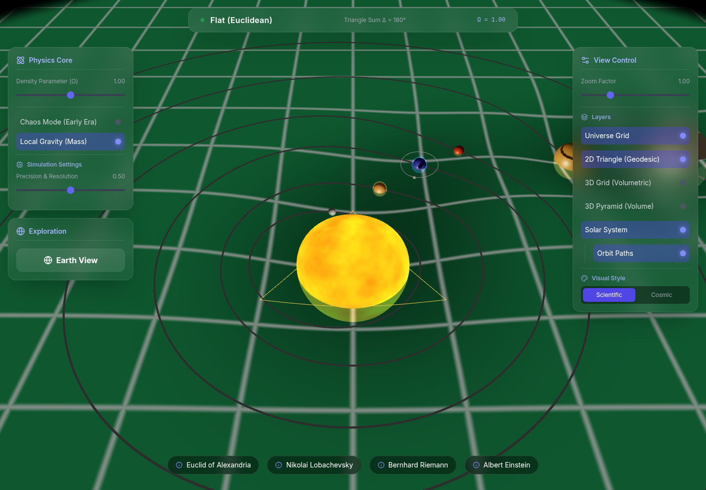
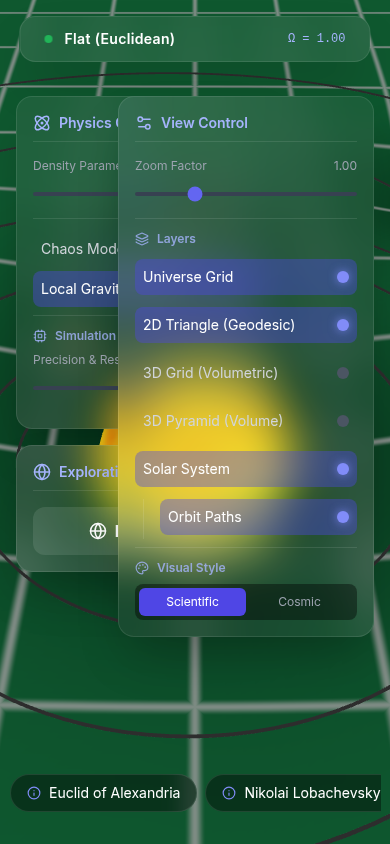

# Исходное состояние — 14 ноября 2026

Проверен коммит `51a6033`. Цель проверки: первый запуск, изменение модели и доступность управления на телефоне. Chromium, 1440×1000 и 390×844. Это экспертная проверка, не исследование с реальными пользователями.

## 1. Первый экран — требует переработки

Отрисовка работает, параметры доступны, однако экран не объясняет учебную задачу. Солнце перекрывает треугольник. Подпись о сумме углов не связана с измерением. Англоязычные термины и множество равнозначных переключателей не дают понятного первого действия. Научные дефекты подтверждены чтением реализации: см. ../research/science.md.

## 2. Мобильный экран — блокирует работу

Две фиксированные панели перекрывают друг друга. Часть текста, управления и нижних элементов обрезана. Отсутствие горизонтального overflow не означает адаптивность: контейнер скрывает элементы. Область опыта практически недоступна.

## 3. Доступность — неполная

На снимках недостаточный визуальный приоритет действий и перегруженный фон. Доказательств поддержки клавиатуры и скринридера нет. Скриншоты не доказывают соответствие WCAG. Новая версия проверяется отдельными keyboard/axe тестами.

## Метод и ограничения

Общий просмотрщик Cloud не подключился (`the gaas-browser node_repl sandbox cannot be disabled`). Снимки получены автоматизированным Chromium из запущенного приложения и просмотрены перед включением в отчёт. Проверки исходника отдельно от визуальных наблюдений. Шесть старых unit-тестов и успешная сборка не являются визуальной или научной приёмкой.
