# Цикл 2 — независимая проверка учебного пути

Проверено 15 ноября 2026 по Киеву. База: `c8de17f` в `product/universe-lab`. Проверялась запущенная production-сборка `http://127.0.0.1:4173`, не исходник как замена взаимодействию. Chromium headless, отдельный Playwright-скрипт (без общего test runner), 390×844 для мобильного пути и 1440×900 для проверки обмена ссылкой. Это экспертный проход, не исследование с настоящими учащимися. Код продукта не менялся.

Цель: человек без подготовки открывает опыт, проверяет свой вывод, переходит к следующему опыту и делится состоянием. Дополнительно проверена сохранность китайского языка.

## Шаги и состояние

| Шаг | Действие | Состояние |
| --- | --- | --- |
| 1 | Открыть начальный маршрут RU | Читаемая компоновка, панели не перекрываются; первый эксперимент находится ниже первого экрана. Это наблюдение, не само по себе дефект. |
| 2 | Выбрать неправильный вариант первого вопроса и проверить | Объяснение показано, но результат ответа не обозначен. |
| 3 | Нажать «Следующий опыт» внизу урока | Новый урок загружен, но пользователь остаётся у его заключения/контрольного вопроса, пропуская вводную и сам опыт. |
| 4 | Открыть `?lang=zh-CN&lesson=2`, нажать логотип | Происходит неожиданный возврат к русскому. |
| 5 | Запретить clipboard и поделиться свободной лабораторией | Копирование не удалось; видимой обратной связи или ручного поля ссылки нет. |
| 6 | Выбрать правильный ответ и повторить проверку на китайском | Прогресс обновляется при правильном ответе; неправильный китайский ответ имеет ту же неоднозначность результата, что RU. |

Снимки ниже получены в этом запуске и просмотрены перед включением. Консольных ошибок в пройденных сценариях нет. Математика и все возможные браузеры этим проходом не проверялись.

## C2-UX-01 — следующий опыт открывается на заключении, а не на начале

**Приоритет: P1.** Блокирует последовательный учебный путь на телефоне: материал нового опыта существует, но человек сразу попадает к его контрольному вопросу.

**Воспроизведение:** открыть маршрут RU при 390×844; прокрутить до вопроса первого опыта; выбрать любой вариант; нажать «Следующий опыт». Активируется урок 02, однако сохраняются scroll/focus предыдущей страницы.

**Наблюдение:** после нажатия `scrollY=2649`, верх нового заголовка `getBoundingClientRect().top=-1759.203125`; активный элемент всё ещё «Следующий опыт». В текущем viewport виден вопрос «Что опровергает треугольник с суммой 270°?» и пояснение, а не вводная и интерактивный эксперимент.

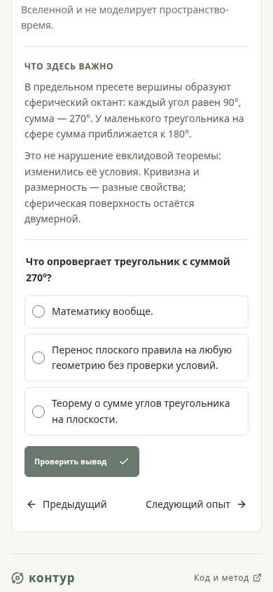

**Источник:** `openLesson` в `src/App.tsx` меняет состояние и сбрасывает ответ, но не устанавливает фокус/позицию. Проверено реальным кликом, не только чтением.

**Критерий исправления:** при намеренном переходе Next/Previous фокус переходит на заголовок выбранного опыта, начало урока видно без ручной перемотки; нет нежелательного скролла от изменения параметров, языка или восстановления URL; `prefers-reduced-motion` не вызывает плавного движения.

## C2-UX-02 — ошибка копирования скрыта в лаборатории и оторвана от кнопки в маршруте

**Приоритет: P2.** Пользователь не знает, удалось ли поделиться, и не получает обещанный обходной способ.

**Воспроизведение:** заменить `navigator.clipboard.writeText` на отклонение `NotAllowedError` (симулирует запрет разрешения/недоступность API); открыть `?view=lab&lab=geometry`; нажать «Поделиться опытом».

**Наблюдение:** текста fallback в DOM нет (`count=0`), `role=alert` нет, кнопка остаётся «Поделиться опытом». В route тот же fallback записан в `.feedback` контрольного вопроса на `top=2505px`, далеко от нажатой кнопки и смешан с объяснением ответа. Ошибка не показана ни как локальный статус, ни как доступный ручной URL.

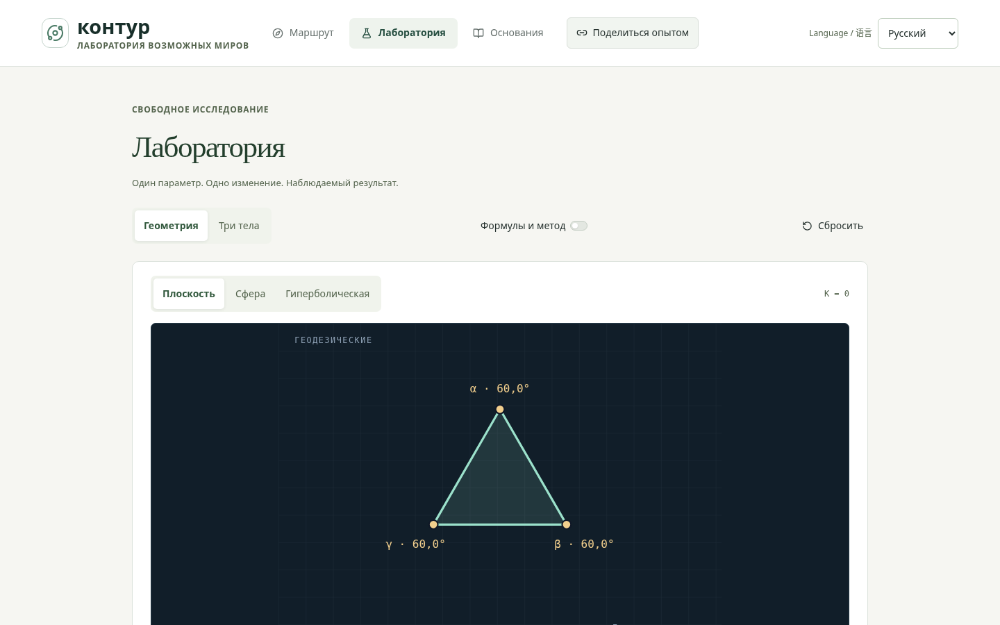

**Источник:** `share` использует `setFeedback`, а `.feedback` отрисован только внутри quiz ветки journey.

**Критерий исправления:** доступный статус/ручное поле ссылки рядом с кнопкой работает в route/lab/library на обоих языках; ошибка clipboard не меняет обратную связь quiz; успешное копирование продолжает работать; fallback URL совпадает с фактическим состоянием опыта.

## C2-UX-03 — логотип сбрасывает китайскую локаль

**Приоритет: P2.** Дефект обычной навигации, воспроизводится без повреждённого состояния.

**Воспроизведение:** открыть `?lang=zh-CN&lesson=2`; язык страницы `zh-CN`; нажать «界线» в заголовке.

**Наблюдение:** логотип ведёт на `?`. Приложение вновь инициализируется, язык становится `ru`, URL содержит `lang=ru`, китайский читатель видит русскую главную страницу. Данные прогресса не стираются, но выбранная локаль теряется.

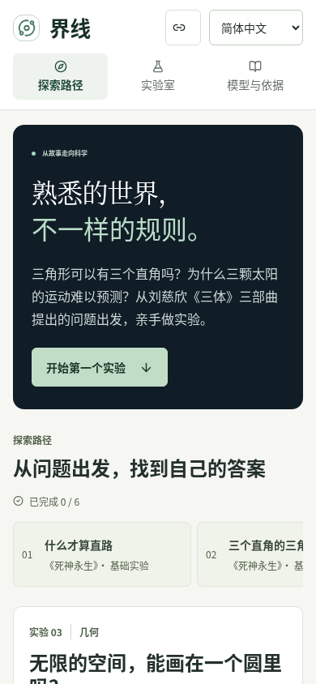
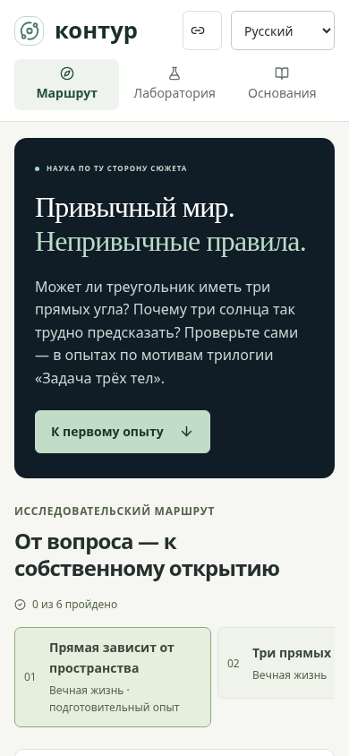

**Критерий исправления:** home/brand сохраняет явно выбранную локаль; китайский пользователь возвращается к старту на китайском; переключение языка остаётся единственным явным способом изменить локаль. Проверить также клавиатурную активацию логотипа.

## C2-UX-04 — проверка неправильного вывода не сообщает, что ответ неправильный

**Приоритет: P2.** Ослабляет обратную связь, которая является основой учебного сценария.

**Воспроизведение:** в уроке 01 RU выбрать «По плоской картинке на экране.»; нажать «Проверить вывод». Для сравнения выбрать «По геометрии поверхности сферы.» и проверить. Затем повторить неверный ответ в уроке 02 ZH («数学不再成立。»).

**Наблюдение:** неправильный ответ сохраняет зелёное оформление выбранного варианта и получает то же нейтральное объяснение, что правильный. Только при верном ответе добавляется исторический бейдж «Опыт пройден»; неверный вывод явно не назван неверным и не подсказан следующий шаг. Прогресс правильно остаётся `0 из 6`, но расположенный далеко счётчик не заменяет результат рядом с ответом.

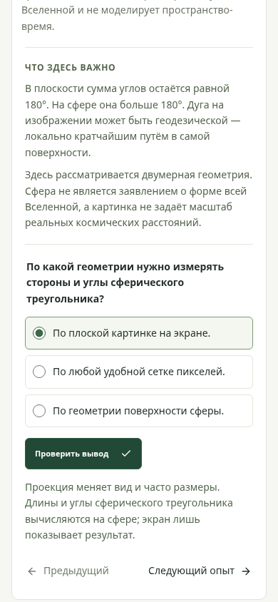
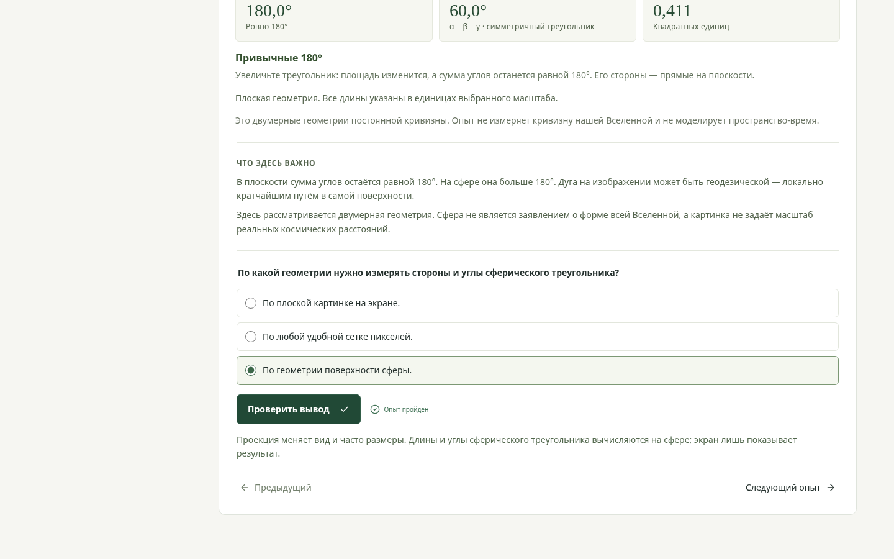
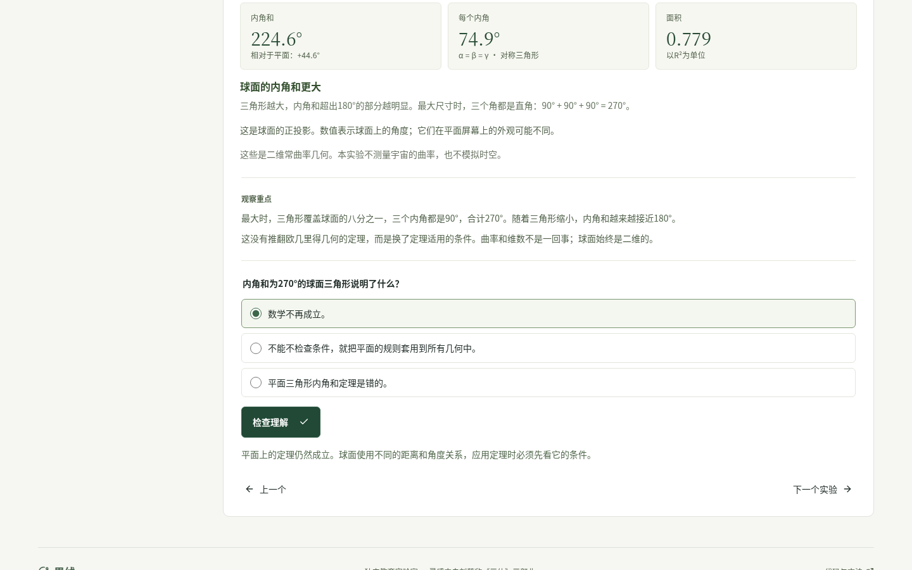

**Критерий исправления:** локальный live-status явно различает «верно» / «попробуйте ещё» на RU/ZH; неверный ответ не увеличивает прогресс; повторная попытка доступна; состояние не кодируется одним цветом. Исторически пройденный опыт и результат текущей попытки различимы.

## Что в этом цикле не является доказанным дефектом

Длинная мобильная страница сама по себе не признана ошибкой: текст последовательно доступен, элементы не перекрываются. Нет данных реальных людей, чтобы утверждать оптимальную длительность урока или объём чтения. Нельзя объявлять непроверенный пользовательский эффект доказанным только по экспертному просмотру.

Для научной корректности, браузерных движков, экранного диктора, обучения школьников и естественности китайского нужны отдельные проверки. Этот документ даёт узкие воспроизводимые входы для следующих карточек.

## Повторная независимая приёмка исправлений #14–16

Проверка выполнена после новой production-сборки 15 ноября 2026 по Киеву: отдельный Chromium / собственный скрипт, 390×844, `reducedMotion: reduce`. Исходные наблюдения выше оставлены как журнал, а не переписаны задним числом. Общий e2e runner не запускался и не присваивается этому ревью.

**Решение: перечисленные четыре исходных UX-дефекта исправлены в проверенных сценариях.**

| Проверка | Полученное свидетельство |
| --- | --- |
| Next / Previous | Заголовок нового опыта получает фокус и появляется в viewport: `top=113.796875px`. При Next с урока 01 на 02 и возврате Previous focus соответствует текущему вопросу. Нет перехода сразу к quiz; использована системная настройка уменьшенного движения. |
| История | В свободной лаборатории два изменения ползунка оставили `history.length` равным 7; переход к основаниям увеличил до 8. Browser Back вернул три тела и кадр 2. Параметры не создают по записи истории на каждый шаг. |
| Китайский home | Из `lang=zh-CN&lesson=2` активация логотипа открыла первый опыт с `lang=zh-CN`, документ остался китайским. |
| Clipboard отказ | Во всех `lab/library/journey` появляется одинаковый видимый блок под заголовком, `top=152.390625px`, с `role=status`, read-only input и фактическим URL. Он не использует quiz feedback. |
| Неверный/верный ответ | Неверный ответ локально сообщает «Пока не совсем… попробуйте снова», верный — «Верно. Вывод подтверждён». Пояснение остаётся доступным. Ошибка не обозначается только цветом. |
| Сброс прогресса | После успешного ответа отмена сброса сохранила `1 из 6`; подтверждение очистило до `0 из 6`. Фокус вернулся на кнопку сброса. |

Новые свидетельства просмотрены:

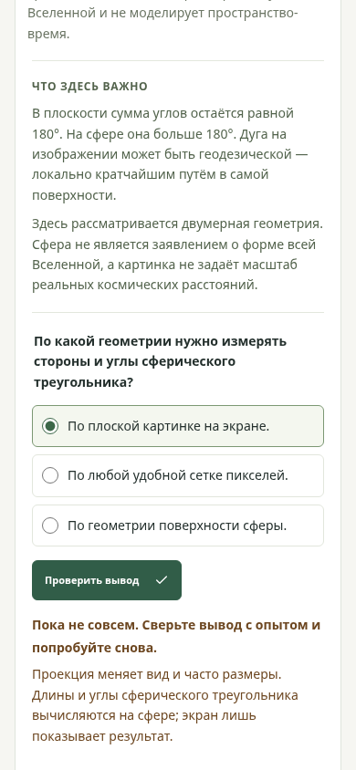
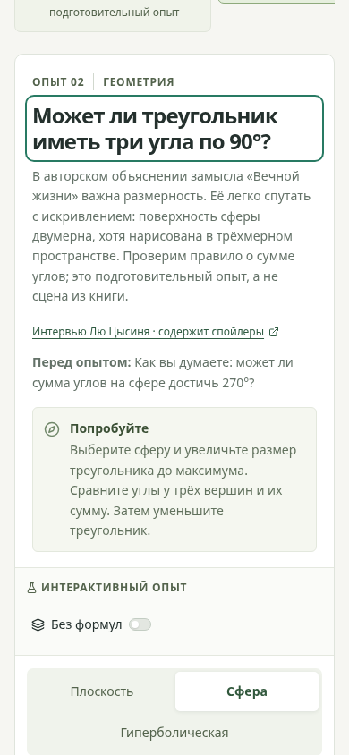
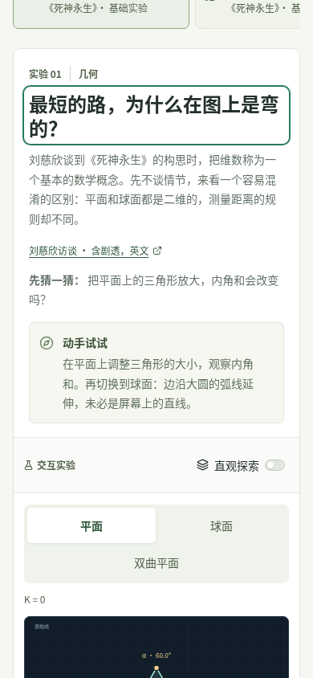
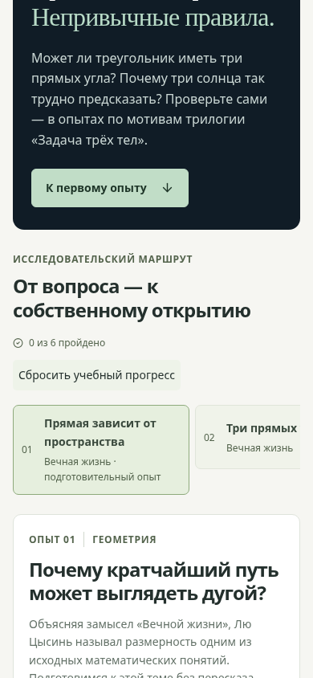
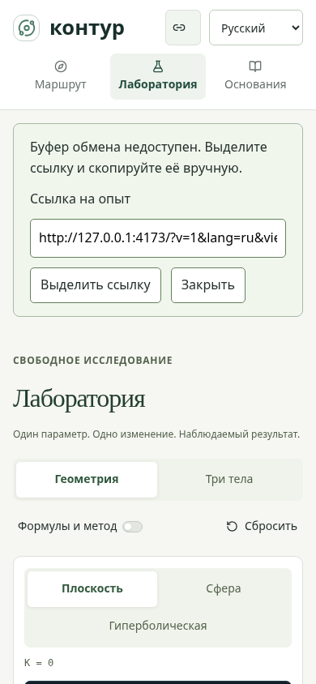

Необработанных ошибок страницы в этом прогоне не было. Проверка не доказывает понятность для настоящего школьника, корректность экранного диктора или поведение всех платформ. Корректность хранения при повреждённых данных и вычислительные модели проверяются отдельными unit/e2e и научными отчётами.

## Финальный визуальный срез C2-04 / C2-05

После сборки с фиксированным видом дополнительно проверена мобильная версия 390×844 в RU и ZH. Использован отдельный браузерный скрипт; source/test runner не менялись.

**Решение: блокирующих визуальных дефектов в этом срезе не обнаружено.**

- Для пресета `chaotic` в `t=0` три основных маркера имеют одинаковые SVG-координаты до включения сравнения, после включения и после установки Δv на максимум: `[(272.5,232.6451612903226),(325.7258064516129,232.6451612903226),(301.7741935483871,200.70967741935485)]`. Изменение сравнения не двигает камеру и не создаёт ложного движения исходной системы.
- Интерфейс явно сообщает, что сохранённые кадры идут через `0,036` модельной единицы времени, а масштаб и центр фиксированы для пресета. Подпись не называет это внутренним шагом интегратора.
- В момент `t=20` показаны обе энергии и обе ошибки: у базовой траектории E₀/E(t)≈−1,00690, дрейф `1,83e−6%`; у сравнения E₀/E(t)≈−1,00692, дрейф `5,40e−7%`. Текст поясняет расчёт относительно собственной начальной энергии. Это визуальная сверка наличия/привязки диагностик, не независимый численный эталон.
- В ZH та же таблица использует десятичную точку, строки `基准/对照`, подпись `同一时刻两条轨道的能量`. Страница имеет ширину 390px без горизонтального переполнения.
- Бейдж правильного ответа теперь «Ответ проверен»; рядом остаётся явное «Верно. Вывод подтверждён». Это точнее описывает действие, чем прежнее «Опыт пройден»: UI не утверждает, что человек провёл опыт только потому, что ответил на вопрос.

Свежие снимки просмотрены:

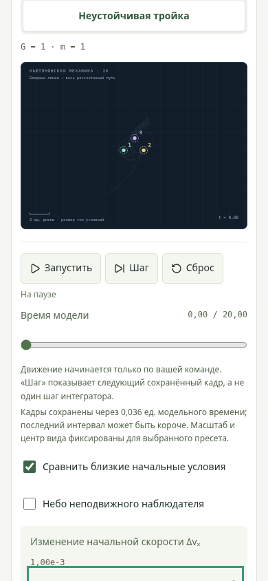
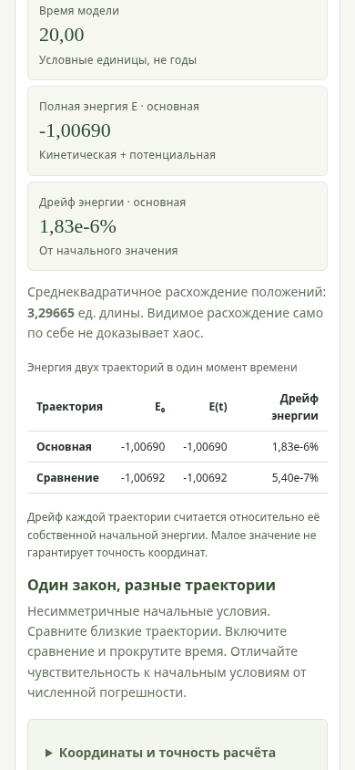
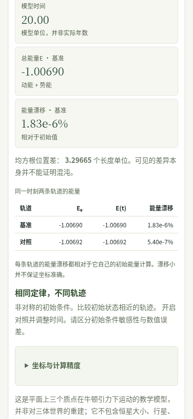
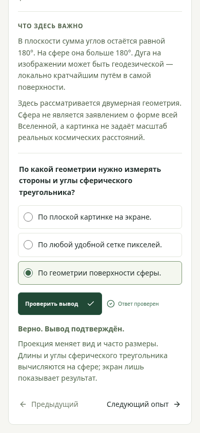

Оставшаяся неблокирующая возможность для следующего исследования: у широко расходящегося `chaotic` пресета начальные тела занимают небольшую область мобильной сцены, поскольку показывается общий фиксированный диапазон. Менять этот диапазон автоматически при включении сравнения нельзя; возможный отдельный ручной zoom потребует собственной приёмки и ясного масштаба.
