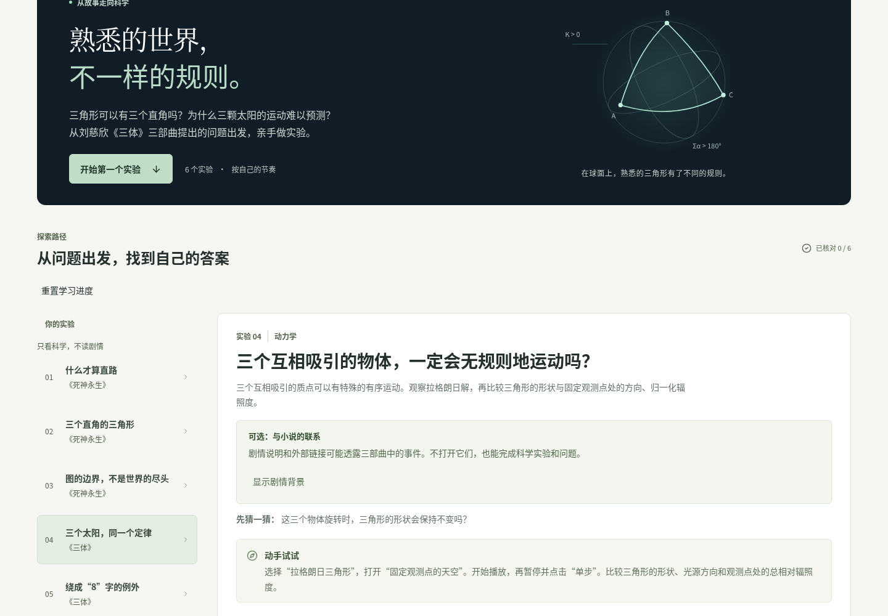
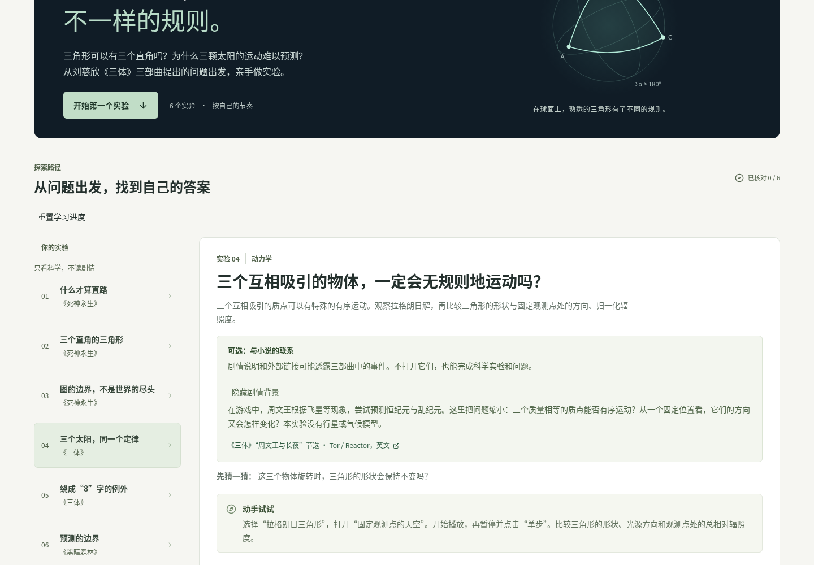
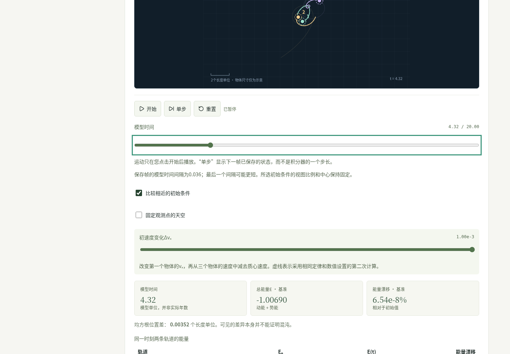
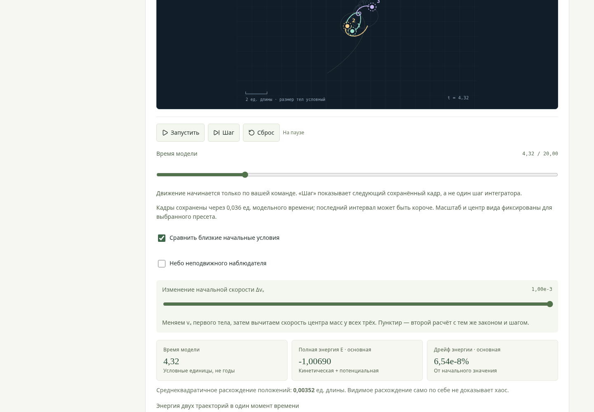
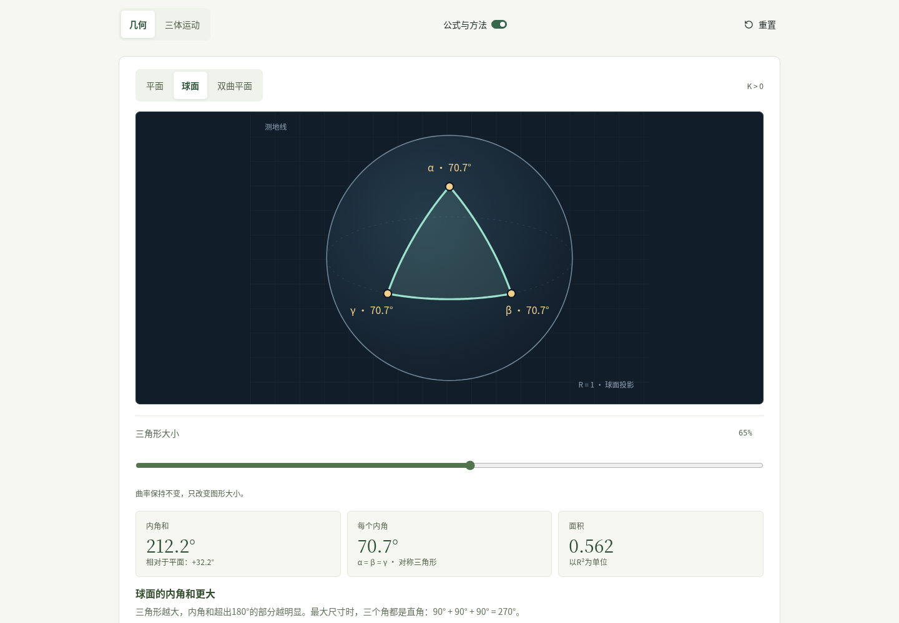
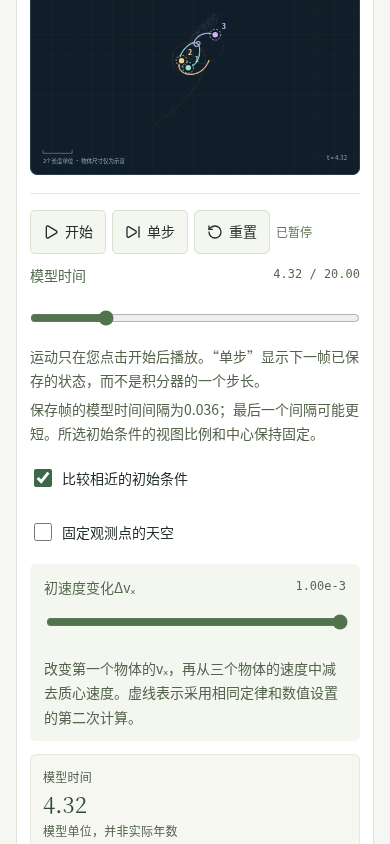
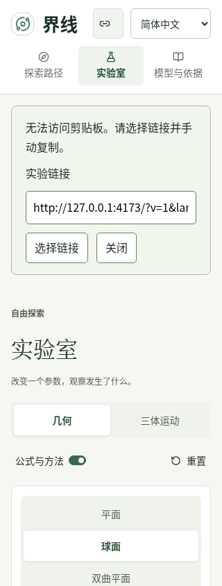

# RAPID: преподаватель, китайский контекст и воспроизведение опыта

**Решение Input: сценарии T05/T06 и проверенная часть C03 пригодны для выпуска.** Блокирующих дефектов в описанном проходе не найдено. Это экспертная проверка агента по ролям P05/P06, а не наблюдение за преподавателем, читателем оригинала или носителем китайского языка. Неявные ожидания этих людей и учебный эффект не считаются подтверждёнными.

Проверка: 14.11.2026, 22:39 UTC; локальная production-сборка `http://127.0.0.1:4173`, ветка `release/rapid-v1`, bundle `index-BHjXPrRY.js`, SHA-256 `88c7a76af3f1ad87bed27037eeb36e959136613b4ab1ad0677ff1709d7b7f82a`. Базовый commit `af7ed5978858b5a6cfc11c2bb348ac4fb45aa668` с кандидатными изменениями; итоговый commit связывает [решение RAPID](rapid-decision.md). Все доказательства ниже сняты на указанном финальном bundle после его сборки.

Среда: headless Chromium 156.0.8078.79, Linux; 1440×1000, 390×844 и 320×844. Использован отдельный Playwright-сеанс без полного test runner. Взаимодействие — доступные имена контролов, клики и клавиши Home/End/ArrowRight; проверены DOM, URL, текст, значения и свежие скриншоты. [Машиночитаемый журнал](rapid/teaching-measurements.json) содержит исходные ссылки и результаты. Нет ошибок `pageerror` в основном проходе.

## Сценарии и факты

| Шаг | Задание и действие эксперта | Наблюдение | Итог |
| --- | --- | --- | --- |
| 1 | T05/P05: открыть опыт 04 на 简体中文, не раскрывая сюжет | Научный контекст и управление доступны. `story-content` отсутствует в DOM. Видно предупреждение и отдельное действие 显示剧情背景 | Пройдено: сохранён безопасный вход |
| 2 | Добровольно открыть связь с романом в опыте 04 | Появляются 周文王, 飞星, 恒纪元 / 乱纪元; текст явно сужает задачу до трёх равных точечных масс и исключает планету/климат. Источник помечен 英文 | Пройдено: происхождение мотива и предел различимы |
| 3 | Перейти в опыт 06, открыть контекст, включить сравнение, увеличить Δvₓ до 0.001 и перейти на кадр 120 | При переходе прежнее раскрытие не переносится. Текст называет аналогией неполное знание состояния, не моделирует решения людей. Время 4.32; RMS 0.00352; рядом сказано, что видимое различие само по себе не доказывает 混沌 | Пройдено: эпохи повествования не приравнены математическому хаосу |
| 4 | C03: сменить язык с zh-CN на RU в этом состоянии | `lesson=5`, `preset=chaotic`, `compare=1`, `dv=10`, `frame=120` сохраняются. 4.32 становится 4,32; энергии −1.00690 / −1.00692 становятся −1,00690 / −1,00692. Раскрытие сюжета сброшено | Пройдено: меняется представление чисел, а не состояние опыта |
| 5 | T06/P06: скопировать ссылку, открыть в совершенно новом контексте браузера | Адрес совпал, восстановлены параметры и кадр. Совпали обе строки энергии и экранные координаты всех шести маркеров основной/сравниваемой траекторий. Сюжет у получателя скрыт | Пройдено: выбранное наблюдение воспроизводимо |
| 6 | У получателя запустить, поставить на паузу, выполнить «Шаг», «Сброс»; открыть «Основания», вернуться «Назад» | Пауза на кадре 124 (t=4,46), шаг на 125; сброс на 0, состояние «На паузе». Возврат восстанавливает URL опыта. Подсказка уточняет, что шаг — сохранённый кадр, не шаг интегратора | Пройдено: ведущий может остановить и повторить показ |
| 7 | T06/C03: выбрать сферу, размер 65%, формулы; поделиться и открыть заново, затем сменить на zh-CN | В новом контексте совпал весь численный блок. При переводе сохранены `size=0.65`, `geometry=sphere`, `level=research`; сумма 212.2°, площадь 0.562. Есть пояснение о проекции и границе модели | Пройдено: воспроизводится и геометрический опыт |
| 8 | C03: проверить источники на zh-CN, ширины 390/320, затем отказ clipboard | Источники помечены 英文; ссылки на исходники открыто обозначены. Общая ширина документа равна viewport; кнопки и подписи не перекрываются в просмотренных состояниях. Единственная кириллица — собственное название варианта языка «Русский». При отказе буфера видны доступное поле полной ссылки и действия выбора/закрытия | Пройдено в проверенной среде |

## Визуальные доказательства

Каждый файл открыт и осмотрен после сохранения. Скриншоты показывают соответствующий шаг, без загрузочных или пустых состояний. Позиция прокрутки выбрана для проверяемой области, а не для полного экрана маршрута.

1. **Научный вход без раскрытия — исправен.** Контекст доступен отдельно, предупреждение стоит до события.

2. **Добровольный литературный контекст — исправен.** Названия эпох и ограничение модели читаемы в одном блоке.

3. **Сравнение начальных состояний — исправно.** Виден фокус на шкале времени, величина Δvₓ, энергия и оговорка о 混沌.

4. **Полученная ссылка — исправна.** Русская версия показывает тот же кадр 4,32 и RMS 0,00352; управление не скрыто формулами.

5. **Геометрия и форматы чисел — исправны.** Размер 65%, значения углов и площади согласованы, подписи на китайском.

6. **Мобильный блок управления — исправен в эмуляции.** Элементы идут последовательно; китайские строки переносятся без перекрытия контролов.

7. **Отказ буфера — исправен.** Поле прокручивает длинный URL внутри себя; ширина страницы не растёт, есть явное действие выделения.

## Смысл и основания

Для P05 используются [POP-01/07 — распространение книг, POP-06 — китайский сериал и POP-08 — опубликованный опрос](../research/audience-popularity.md). POP-08 даёт повод проверять логику объяснения и культурный контекст, но не доказывает спрос на «Контур». Три входа — только Tencent, только оригинал, оба — остаются разными возможными историями знакомства; в этом проходе их не изображали тремя реальными людьми.

Термины текущего текста согласованы с [китайской научной проверкой](../research/chinese-science.md): 恒纪元 / 乱纪元 относятся к повествованию; 混沌 — к динамике; 初始条件 не тождественны погрешности; 投影 не означает физическое 降维. Эксперт обнаруживает эти различия в интерфейсе, но это не означает, что любой читатель поймёт их без затруднения. Указание 英文 на источниках позволяет заранее понять язык перехода; доступность самих внешних сайтов заново не проверялась.

P06 обеспечен средствами для последовательности «предсказать → изменить → объяснить»: исходная гипотеза, один изменяемый параметр, пауза, сохранённый кадр, сброс и численное наблюдение. «Ответ проверен» не используется в этом решении как отметка, показатель знаний или доказательство успешного урока. Ссылка переносит параметры опыта, а не личный прогресс; локально раскрытые панели и небо наблюдателя не обещаны частью адреса.

## Остаточные границы решения

- Не проводились урок, интервью, проверка долговременного усвоения, пилот со школьниками, носителями языка или сотрудниками МФТИ. Для будущего эмпирического исследования сохранена [отдельная карточка #23](https://github.com/mmkolpakov/Geometry-System/issues/23).
- Китайская терминология проверена экспертно по текущему тексту и словарю; нативная редактура и наблюдение за чтением отсутствуют. Размеры текста, контраст и доступные имена не дают сами по себе сертификата доступности.
- Мобильные размеры проверены в Chromium; физические iOS/Android, системные увеличения и экранные дикторы этим проходом не покрыты. Скриншот не подтверждает удобство касания и произношение формул.
- Раскрытие сюжета действует только локально; перед передачей ссылки учитель должен учитывать, что получатель сам выбирает чтение контекста. Это намеренное поведение, проверенное у нового получателя.
- Полноценный планетарный наблюдатель, климат и реконструкция сцен сериала/романа остаются за пределами модели. T05 подтверждает честность текущей аналогии, а не завершение [#12](https://github.com/mmkolpakov/Geometry-System/issues/12).

Для заявленного объёма шести опытов дополнительных обязательных изменений по P05/P06 не требуется. Следующий шаг — связать этот Input с независимыми Agree и итоговым решением выпуска, сохранив перечисленные границы.

## Перенос Input на итоговую сборку после очистки

**Текущий Input: PASS для `index-7oaePJm_.js`**, SHA-256 `507765b09b26dd6051c424b2fe9a8125d9e5356b1a61c92a2936679662d34784`. Перепроверка выполнена 14.11.2026 в 22:43 UTC в отдельном Chromium-сеансе на том же локальном production-URL. Семь снимков и основной журнал выше остаются доказательствами предыдущего явно указанного bundle `BHjXPrRY`; им не приписывается новая дата или версия.

Проверена очистка: удалены неиспользуемые React-обвязка i18next, функция определения языка и неиспользуемые ключи китайского словаря. `i18next`, фиксированный переводчик и собственный React-контекст сохранены. Используемые в T05/T06 научные тексты, названия контролов, поля URL и расчётные параметры этим изменением не менялись.

Короткий повтор на итоговой сборке подтвердил:

- В опыте 04 на zh-CN сюжет отсутствует до выбора; после выбора присутствуют 恒纪元 / 乱纪元. Переход в опыт 06 снова закрывает сюжет.
- В опыте 06 сравнение с `dv=10`, `frame=120` даёт 4.32 на zh-CN; переход на RU даёт 4,32 при тех же параметрах. Оговорка «可见的差异本身并不能证明混沌» остаётся видимой.
- Скопированный URL в новом контексте восстанавливает `compare=1`, `dv=10`, `frame=120`, время 4,32 и строку основной энергии −1,00690 / −1,00690 / 6,54e-8%. Сюжет у получателя закрыт.
- «Шаг» переводит кадр 120 в 121; «Сброс» — в 0. Возврат языка отправителя на zh-CN сохраняет кадр 120 и время 4.32. Ошибок `pageerror` не зарегистрировано.

Это целевая проверка переноса после очистки зависимостей, а не новый полный визуальный проход. Решение Input для текущего выпуска положительное в прежних границах P05/P06/C03; эмпирические и аппаратные ограничения выше сохраняются.
